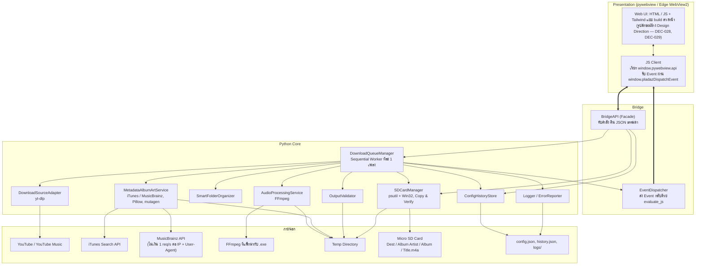
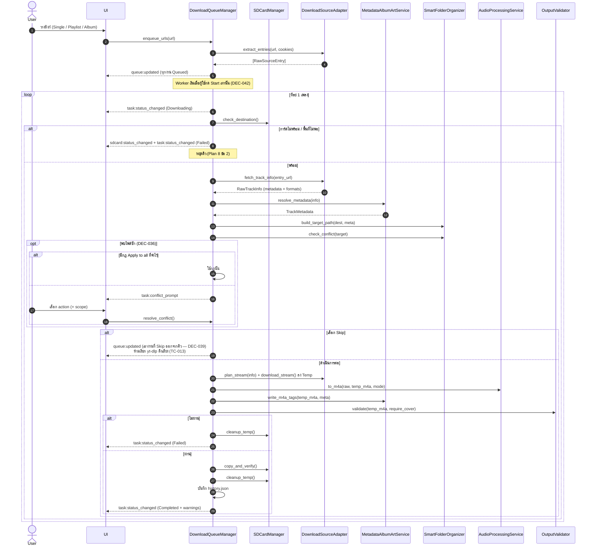
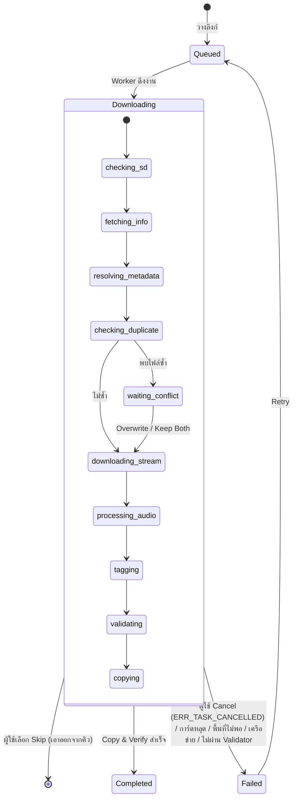

# PLADAZ — เอกสารออกแบบระบบเชิงเทคนิค (System Design Specification)

> **Phase 1 Deliverable — เขียนใหม่ทั้งฉบับ**
>
> **ภาษา:** ไทย  
> **ชื่อโครงการ:** PLADAZ  
> **เวอร์ชันเอกสาร:** 2.4 (อ้างอิง `IMPLEMENT_PLAN.md` เวอร์ชัน 2.7)  
> **แพลตฟอร์มเป้าหมาย:** Windows 10 / 11  
> **อุปกรณ์เป้าหมาย:** SNOWSKY ECHO DAP (Native `.m4a`)  
> **ขอบเขต:** สถาปัตยกรรม, Interface ระหว่างโมดูล, Data Models, Data Flow & Event, Error Handling & Logging, Traceability Matrix ส่วน UI Design แยกอ้างอิงตาม `DEC-028`
> **หัวข้อที่คงสถานะ TBA:** `TBA-023`, `TBA-026`, `TBA-027` (ดูหัวข้อ 6)  
> **สถานะการตรวจสอบ:** พัฒนาครบทั้ง Phase 2 (แกนระบบ), Phase 3 (กระบวนการเพลงและคิว), และ Phase 4 (Frontend 19 บอร์ด, App Shell, และแพ็กเกจ PyInstaller `--onedir`) รันชุดทดสอบ `pytest` ผ่านแล้ว **54 รายการ** (ดูรายละเอียดใน [`PROJECT_PROGRESS.md`](file:///e:/Doc/Code/randombullshit/PLADAZV2/Doc/PROJECT_PROGRESS.md)) ส่วนการทดสอบบน Clean Windows และการทดสอบบนอุปกรณ์จริง SNOWSKY ECHO DAP รอดำเนินการใน Phase 5

---

## 0. วิธีอ่านเอกสารนี้

เอกสารนี้ใช้ป้ายสถานะตามกฎของ Plan หัวข้อ 1 และ 12:

| ป้าย | ความหมาย |
|---|---|
| **[Plan]** | มาจาก Plan v2.2 โดยตรง (IR / DEC / TBA / TC) เปลี่ยนไม่ได้ในเอกสารนี้ |
| **[Proposal]** | ข้อเสนอด้านการออกแบบที่ Plan ไม่ได้กำหนด รอผู้ใช้ยืนยัน |
| **[Design]** | การตัดสินใจด้านการออกแบบภายในเอกสารนี้ ที่ไม่ขัดกับ Plan และไม่ได้อยู่ใน Plan (เปลี่ยนได้โดยไม่ต้องแก้ Plan) |
| **[Unverified]** | ข้อเท็จจริงทางเทคนิคที่มาจากความรู้ทั่วไป ยังไม่ได้ทดสอบกับของจริง |

หลักที่ใช้: ไม่เพิ่มสถานะงานเกิน 4 สถานะ (`IR-017`), ไม่แตะ Immutable Requirements, ไม่ประกาศผลทดสอบที่ยังไม่ได้รัน

---

## 1. ภาพสถาปัตยกรรมระบบ

### 1.1 แผนภาพภาพรวม (`pywebview UI <-> Native JS Bridge <-> Python Core`) [Plan: IR-012, IR-015, DEC-017]

หน้าบ้านกับหลังบ้านแยกกัน สื่อสารผ่าน Bridge ในโปรเซสเดียวกันของ `pywebview` ไม่เปิดพอร์ตเครือข่าย



หมายเหตุจากรอบ review: ข้อจำกัด 1 req/s เป็นของ **MusicBrainz** เท่านั้น (ตรวจจาก MusicBrainz Rate Limiting เมื่อ 2026-10-23 ตาม Plan 7.2) ส่วน iTunes ไม่ได้อยู่ใต้ข้อจำกัดนี้ในแผนภาพ

### 1.2 หลักการแบ่งชั้น [Plan: หัวข้อ 5.1]

- `domain/` ไม่ import `yt-dlp`, `mutagen`, `psutil`, `pywebview` (DIP) เพื่อทดสอบด้วย `pytest` ได้โดยไม่ต้องมี UI หรือ SD Card จริง
- `services/` รับ dependency ผ่าน Protocol ใน `domain/interfaces.py`
- `bridge/` เป็นชั้นเดียวที่รู้จัก `pywebview`

### 1.3 โครงสร้างไดเรกทอรี [Proposal]

```text
PLADAZV2/
├── Doc/
│   ├── IMPLEMENT_PLAN.md
│   ├── SYSTEM_DESIGN.md
│   ├── PLADAZ — Design Direction & Handoff.md
│   └── PLADAZ UI Mockup.html
├── src/pladaz/
│   ├── __init__.py              # __version__ เริ่ม 1.0.0 (DEC-026)
│   ├── paths.py                 # แยก Path ระหว่างโหมดพัฒนาและโหมด sys.frozen (--onedir) (DEC-023, DEC-038, DEC-046)
│   ├── main.py                  # สร้าง Window (1280x820, min 380x600), ผูก BridgeAPI, ล้าง Temp ค้างตอนเปิดแอป
│   ├── bridge/
│   │   ├── api.py               # BridgeAPI
│   │   ├── dto.py               # TaskDTO, SDCardDTO ฯลฯ (แปลงเป็น JSON ได้)
│   │   └── events.py            # EventDispatcher
│   ├── domain/
│   │   ├── models.py
│   │   ├── enums.py
│   │   ├── errors.py            # Exception แต่ละชนิด
│   │   └── interfaces.py        # Protocols
│   └── services/
│       ├── queue_manager.py
│       ├── source_adapter.py
│       ├── audio_processor.py
│       ├── metadata_service.py
│       ├── metadata_matcher.py  # จุดเสียบ TBA-026
│       ├── folder_organizer.py
│       ├── output_validator.py
│       ├── sd_card_manager.py
│       ├── config_store.py
│       └── logger.py
├── ui/                          # Web assets (index.html, js/bridge.js, js/app.js, app.built.css, fonts/*.woff2)
├── ui_src/                      # ต้นทาง Tailwind (input.css) + tailwind.config.js (build ล่วงหน้า, DEC-029, DEC-045)
├── bin/
│   ├── ffmpeg.exe               # FFmpeg binary (~166 MB)
│   └── yt-dlp.exe               # yt-dlp binary (~17.8 MB) — อัปเดต in-place ได้ (DEC-038, DEC-046)
│                                # *หมายเหตุ: ตัด ffprobe.exe ออก เพราะตรวจสอบด้วย mutagen โดยตรง ประหยัดไป ~227 MB
├── pladaz.spec                  # PyInstaller spec โหมด --onedir (แพ็ก binaries ลง _internal/bin/, DEC-018, DEC-046)
└── tests/
    ├── conftest.py
    ├── test_phase4_bridge_and_shell.py # ทดสอบ App Shell, Portable Paths, BridgeAPI และความสมบูรณ์ของออฟไลน์ UI Bundle
    ├── unit/
    │   ├── test_folder_organizer.py     # TC-002, 003, 011, 012, 025, 027
    │   ├── test_metadata_rules.py       # TC-004, 005, 006, 007, 011, 026
    │   ├── test_output_validator.py     # TC-014, 020, 022, 023
    │   ├── test_conflict_resolution.py  # TC-013, TC-033
    │   ├── test_logger.py               # TC-017, TC-032
    │   ├── test_config_store.py         # TC-029, TC-030
    │   └── test_source_adapter.py       # TC-031 (ใช้ yt-dlp.exe จำลอง)
    └── integration/
        ├── test_audio_pipeline.py       # TC-024
        ├── test_sd_card_manager.py      # TC-008, 009, 010, 019, 028
        └── test_queue_worker.py         # TC-016, TC-018
```

TC-001 และ TC-015 ไม่ใช่การทดสอบอัตโนมัติ (TC-001 รันแอปบน Windows, TC-015 ต้องใช้เครื่อง ECHO จริง) จึงไม่อยู่ใน `tests/`

---

## 2. Data Models และ Interface

### 2.1 Enums [Plan: IR-017, DEC-019, DEC-033]

```python
from enum import Enum

class TaskStatus(str, Enum):          # IR-017 มี 4 สถานะเท่านั้น
    QUEUED = "Queued"
    DOWNLOADING = "Downloading"
    COMPLETED = "Completed"
    FAILED = "Failed"

class ConflictAction(str, Enum):      # DEC-019
    OVERWRITE = "overwrite"
    SKIP = "skip"
    KEEP_BOTH = "keep_both"

class ConflictScope(str, Enum):       # DEC-019, DEC-044
    SINGLE = "single"
    ALBUM = "album"
    QUEUE = "queue"

class AudioProcessMode(str, Enum):    # DEC-033
    REMUX_AAC = "remux_aac"
    ENCODE_AAC_LC = "encode_aac_lc"

class Stage(str, Enum):               # ขั้นตอนย่อยในสถานะ Downloading (ไม่ใช่สถานะหลัก)
    CHECKING_SD = "checking_sd"
    FETCHING_INFO = "fetching_info"
    RESOLVING_METADATA = "resolving_metadata"
    CHECKING_DUPLICATE = "checking_duplicate"
    WAITING_CONFLICT = "waiting_conflict"
    DOWNLOADING_STREAM = "downloading_stream"
    PROCESSING_AUDIO = "processing_audio"
    TAGGING = "tagging"
    VALIDATING = "validating"
    COPYING = "copying"
```

### 2.2 Data Classes [Proposal]

ชนิดข้อมูลที่รอบ review พบว่าใช้แต่ไม่ได้นิยาม ถูกนิยามครบในหัวข้อนี้

```python
from dataclasses import dataclass, field
from pathlib import Path
from typing import Optional

@dataclass
class TrackMetadata:
    """9 ฟิลด์ตาม Plan 2.1  ค่า None = เว้นว่างในแท็ก (Plan 7.3 ห้ามใส่ค่าหลอก)"""
    title: str                                  # บังคับ (DEC-030)
    track_artist: Optional[str] = None
    album: Optional[str] = None
    album_artist: Optional[str] = None
    track_number: Optional[int] = None
    total_tracks: Optional[int] = None
    disc_number: Optional[int] = None
    total_discs: Optional[int] = None
    year: Optional[str] = None
    genre: Optional[str] = None
    cover_jpeg: Optional[bytes] = None          # 800x800 JPEG (DEC-021)
    # หมายเหตุ: total_tracks / total_discs เป็นค่าประกอบของ atom trkn/disk
    # Plan ไม่ได้ระบุว่าต้องหาค่านี้ ถ้าไม่มี ให้เขียน 0 ตามธรรมเนียม MP4

@dataclass
class RawSourceEntry:
    """ผลจากการแตกลิงก์ (ขั้นเบา ไม่มี formats)"""
    entry_url: str
    title_hint: Optional[str] = None
    batch_id: str = ""
    index_in_batch: int = 0

@dataclass
class RawTrackInfo:
    """ข้อมูลเต็มของ 1 แทร็กจาก yt-dlp  ได้ทั้ง metadata และ formats ในการเรียกครั้งเดียว"""
    entry_url: str
    title: Optional[str]
    artist: Optional[str]
    album: Optional[str]
    album_artist: Optional[str]
    track_number: Optional[int]
    disc_number: Optional[int]
    release_year: Optional[str]
    genre: Optional[str]
    thumbnail_url: Optional[str]
    audio_formats: list["AudioFormat"]

@dataclass
class AudioFormat:
    format_id: str
    acodec: str                                 # เช่น "mp4a.40.2", "opus"
    abr: Optional[float]
    ext: str

@dataclass
class StreamPlan:
    format_id: str
    mode: AudioProcessMode

@dataclass
class ExternalMetadata:
    """ผลค้นหาจาก iTunes/MusicBrainz 1 รายการ"""
    source: str                                 # "itunes" | "musicbrainz"
    title: str
    artist: str
    album: Optional[str] = None
    album_artist: Optional[str] = None
    track_number: Optional[int] = None
    disc_number: Optional[int] = None
    genre: Optional[str] = None
    year: Optional[str] = None
    cover_url: Optional[str] = None

@dataclass
class UpdateResult:
    success: bool
    old_version: Optional[str]
    new_version: Optional[str]
    message: str

@dataclass
class ValidationResult:
    is_valid: bool
    is_readable: bool = False
    is_aac_lc: bool = False
    has_title: bool = False
    has_cover: bool = False
    warnings: list[str] = field(default_factory=list)
    error_code: Optional[str] = None

@dataclass
class SDCardStatus:
    drive_root: str
    destination_dir: str
    is_connected: bool
    is_writable: bool
    free_bytes: int
    total_bytes: int
    volume_label: Optional[str] = None

@dataclass
class StructuredError:
    code: str
    message_en: str                             # UI เป็นภาษาอังกฤษ (DEC-025)
    recoverable: bool
    task_id: Optional[str] = None
    details: Optional[str] = None               # ห้ามมีข้อมูลจาก cookies.txt

@dataclass
class TrackTask:
    """ใช้ภายใน Core เท่านั้น ห้ามส่งข้ามไป UI ตรง ๆ  (ใช้ TaskDTO)"""
    task_id: str
    entry_url: str
    batch_id: str
    status: TaskStatus = TaskStatus.QUEUED
    stage: Optional[Stage] = None
    progress_percent: float = 0.0
    metadata: Optional[TrackMetadata] = None
    temp_file_path: Optional[Path] = None
    target_file_path: Optional[Path] = None
    warnings: list[str] = field(default_factory=list)
    error: Optional[StructuredError] = None

@dataclass
class HistoryEntry:
    """รายการใน history.json (เฉพาะงานที่จบแล้ว)"""
    task_id: str
    finished_at: str                            # ISO 8601
    status: TaskStatus                          # Completed หรือ Failed
    title: Optional[str]
    album_artist: Optional[str]
    album: Optional[str]
    target_file_path: Optional[str]
    source_url: str
    warnings: list[str] = field(default_factory=list)
    error_code: Optional[str] = None
    has_cover: Optional[bool] = None            # None = ไม่ทราบ (ยังไม่ได้ resolve metadata หรือรายการเก่า) (DEC-051)
```

### 2.3 DTO สำหรับข้าม Bridge [Proposal — แก้ข้อผิดพลาดจากรอบ review]

`pywebview` ส่งค่ากลับ JS เป็น JSON ได้เฉพาะชนิดพื้นฐาน `TrackTask` มี `Path`, Enum และ `bytes` (ภาพปก) ที่ serialize ตรง ๆ ไม่ได้ ข้อกำหนด:

- Event และ API ทุกตัวส่ง **`TaskDTO`** เท่านั้น: ฟิลด์เป็น `str`, `int`, `float`, `bool`, `list`, `dict`; Enum ส่งเป็น `.value`; `Path` ส่งเป็น `str`
- `TaskDTO` **ไม่มี** `cover_jpeg` ส่งเฉพาะ `has_cover: bool`
- ถ้า UI ต้องแสดงภาพปกตัวอย่าง ใช้เมธอดแยก `get_cover_preview(task_id)` คืน `data:image/jpeg;base64,...` ที่ย่อขนาดแล้ว (ขนาดภาพตัวอย่างที่ UI ต้องการ: กำหนดตอนออกแบบ UI)

### 2.4 Interface ของโมดูล

```mermaid
classDiagram
    class DownloadSourceAdapter {
        +extract_entries(url, cookies_path) list~RawSourceEntry~
        +fetch_track_info(entry_url, cookies_path) RawTrackInfo
        +plan_stream(info) StreamPlan
        +download_stream(entry_url, plan, temp_dir, progress_cb) Path
        +update_ytdlp() UpdateResult
    }
    class MetadataAlbumArtService {
        +resolve_metadata(info) TrackMetadata
        +enrich_from_external(info) ExternalMetadata or None
        +process_cover(image_bytes) bytes
        +write_m4a_tags(path, meta) None
    }
    class MetadataMatcherProtocol {
        <<Protocol>>
        +is_match(src_title, src_artist, cand_title, cand_artist) bool
    }
    class SmartFolderOrganizer {
        +sanitize_component(name) str
        +resolve_folder_names(meta) tuple
        +build_target_path(dest_root, meta) Path
        +check_conflict(target) bool
        +keep_both_path(target) Path
    }
    class AudioProcessingService {
        +to_m4a(input_path, output_path, mode) Path
    }
    class OutputValidator {
        +validate(path, require_cover) ValidationResult
    }
    class SDCardManager {
        +list_removable_drives() list~SDCardStatus~
        +check_destination(dest, required_bytes) SDCardStatus
        +copy_and_verify(temp_file, target) Path
        +cleanup_temp(path) None
    }
    class DownloadQueueManager {
        +enqueue_url(url) list~TrackTask~
        +resolve_conflict(task_id, action, scope) None
        +retry(task_id) None
        +remove(task_id) None
    }
    class ConfigHistoryStore {
        +load_config() dict
        +save_config(cfg) None
        +append_history(entry) None
        +load_history() list~HistoryEntry~
    }
    MetadataAlbumArtService ..> MetadataMatcherProtocol
    DownloadQueueManager --> DownloadSourceAdapter
    DownloadQueueManager --> MetadataAlbumArtService
    DownloadQueueManager --> SmartFolderOrganizer
    DownloadQueueManager --> AudioProcessingService
    DownloadQueueManager --> OutputValidator
    DownloadQueueManager --> SDCardManager
    DownloadQueueManager --> ConfigHistoryStore
```



คำสั่งควบคุมคิว (`start_queue`, `cancel_task`, `resume_queue`) เพิ่มใน `DownloadQueueManager` ตาม DEC-042 ยังไม่ได้วาดใน diagram

### 2.5 สัญญาของแต่ละโมดูล

**(1) `DownloadSourceAdapter`** — `IR-007`, `IR-016`, `DEC-025`, `DEC-027`, `DEC-033`

- `extract_entries(url, cookies_path)`: ใช้ `yt-dlp` แบบ flat เพื่อแตก Playlist/Album เป็นรายการลิงก์ย่อยอย่างเร็ว คืน `RawSourceEntry` (ยังไม่มี album, track number หรือ formats) ถ้าเป็นลิงก์เพลงเดี่ยวคืน 1 รายการ
- `fetch_track_info(entry_url)`: **[Design]** เรียก `yt-dlp` แบบเต็มต่อ 1 แทร็ก (ไม่ดาวน์โหลดเสียง) ได้ทั้ง metadata และรายการ `formats` ในครั้งเดียว ใช้แก้ลำดับที่ขัดกันในเอกสารรุ่นเดิม (รุ่นเดิมเรียก `resolve_metadata` จากข้อมูล flat แล้วค่อย probe formats ทีหลัง)
- `plan_stream(info)`: ตาม `DEC-033`
  - มีสตรีม AAC-LC (`acodec == "mp4a.40.2"` ใน `m4a`) → เลือกตัวที่ดีที่สุด → `REMUX_AAC`
  - ไม่มี → เลือกสตรีมเสียงที่ดีที่สุด → `ENCODE_AAC_LC`
- `download_stream(...)`: ดาวน์โหลดลง Temp เท่านั้น
- `update_ytdlp()` (DEC-038): ใช้ binary **`yt-dlp.exe`** ซึ่งแพ็กไว้ใน `_internal/bin/yt-dlp.exe` (และรองรับ fallback ค้นหาข้าง `PLADAZ.exe` หรือใน `bin/`) Adapter เรียกผ่าน `subprocess` (ผลข้อมูลอ่านจาก JSON ของ yt-dlp และความคืบหน้าอ่านจากเอาต์พุต) การอัปเดตทำโดยดาวน์โหลดไฟล์ใหม่ไว้เป็นไฟล์ชั่วคราว (`yt-dlp.tmp.exe`), ตรวจสอบ `--version` และสลับแทนที่แบบ atomic (`os.replace`) ตรงตำแหน่งที่ติดตั้ง ถ้าล้มเหลวให้ rollback คงตัวเดิมและส่ง `ERR_YTDLP_UPDATE_FAILED`
  - Plan ปรับถ้อยคำแล้วใน DEC-018, DEC-038, DEC-046 และหัวข้อ 5.3 ข้อ 4

**(2) `MetadataAlbumArtService`** — `DEC-008`, `DEC-021`, `DEC-035`, `TBA-026`

- `resolve_metadata(info)`:
  1. ตั้งต้นจากข้อมูล `yt-dlp`
  2. ถ้า `album_artist`, `album`, `track_number`, `disc_number`, `genre` หรือปกขาด ให้เรียก `enrich_from_external`
  3. ยอมรับผลเสริมก็ต่อเมื่อ `MetadataMatcherProtocol.is_match(...)` ให้ `True` (ชื่อเพลง **และ** ศิลปินตรงกัน — DEC-035) ถ้าไม่ตรง ไม่เติมค่า
  4. ใช้กฎ Plan 7.3: `album_artist` ← `track_artist` ← `None`; ฟิลด์อื่นไม่มี = `None`
- วิธีเทียบ "ตรงกัน" (ตัวพิมพ์ ช่องว่าง `feat.` ฯลฯ) และสตริง User-Agent = **`TBA-026`** จนกว่าจะยืนยัน การทดสอบ TC-026 ใช้ matcher จำลอง (Fake) ไม่ผูกกับอัลกอริทึมจริง
- **เมื่อ API เสริมใช้ไม่ได้** (timeout, HTTP 5xx, 429, ไม่มีเน็ต): ถือว่า "ไม่พบผลค้นหา" เว้นฟิลด์ว่างตาม 7.3 บันทึก `WARNING` ลง Log และเพิ่มคำเตือนใน `TrackTask.warnings` ไม่ทำให้งาน `Failed` **[Proposal]** (Plan ไม่ได้ระบุพฤติกรรมกรณีนี้)
- MusicBrainz: คุมอัตราไม่เกิน 1 request/วินาทีด้วย rate limiter ในตัว client (Plan 7.2)
- `process_cover(image_bytes)`: Pillow → RGB → crop กึ่งกลางเป็นจัตุรัส → 800×800 → JPEG (`DEC-021`)
- `write_m4a_tags(path, meta)`: ตาราง atom ด้านล่าง

| ฟิลด์ (Plan 2.1) | MP4 atom (`mutagen.mp4`) | ค่าที่เขียน | เมื่อไม่มีข้อมูล (7.3) |
|---|---|---|---|
| Title | `©nam` | `[str]` | บังคับต้องมี (DEC-030) |
| Track Artist | `©ART` | `[str]` | ไม่เขียนคีย์ |
| Album | `©alb` | `[str]` | ไม่เขียนคีย์ |
| Album Artist | `aART` | `[str]` (fallback = Track Artist) | ไม่มีทั้งคู่ → ไม่เขียนคีย์ |
| Track Number | `trkn` | `[(n, total or 0)]` | ไม่เขียนคีย์ |
| Disc Number | `disk` | `[(n, total or 0)]` | ไม่เขียนคีย์ |
| Year | `©day` | `[str]` | ไม่เขียนคีย์ |
| Genre | `©gen` | `[str]` | ไม่เขียนคีย์ |
| Album Art | `covr` | `[MP4Cover(jpeg, FORMAT_JPEG)]` | ไม่เขียนคีย์ |

> เอกสารรุ่นเดิมเขียนชื่อ atom ของ Track Artist เป็น `©art` (ตัวพิมพ์เล็ก) ใน `mutagen` คีย์ที่ถูกต้องคือ `©ART` (`\xa9ART`) ตัวพิมพ์ใหญ่ **[Verified ใน Phase 2]** ยืนยันจากซอร์สโค้ด `mutagen.mp4` และการเขียน-อ่านไฟล์ `.m4a` จริงใน `tests/unit/test_metadata_rules.py` (TC-004) แล้ว

**(3) `SmartFolderOrganizer`** — `IR-011`, `IR-018`, `DEC-014`, `DEC-022`, `DEC-034`

`sanitize_component(name)` ทำตามลำดับ (DEC-037):

1. แปลง `\ / : * ? " < > |` **และอักขระควบคุม ASCII 0x00–0x1F** เป็น `_`
2. ตัดความยาวไม่เกิน 100 อักขระ [Plan]
3. อักขระ **จุดหรือช่องว่างที่อยู่ท้ายชื่อทุกตัว** แปลงเป็น `_` (เช่น `Hello...` → `Hello___`) หลังขั้นตัดความยาว
4. ตรวจชื่อสงวน `CON, PRN, AUX, NUL, COM1–9, LPT1–9` (ไม่สนตัวพิมพ์) กับ **ส่วนก่อนจุดแรก** ของชื่อ ถ้าตรงให้ต่อท้ายส่วนนั้นด้วย `_` (เช่น `CON` → `CON_`, `CON.mix` → `CON_.mix`)

**อ้างอิง Plan:** กฎนี้ตรงกับหัวข้อ 6.2 ข้อ 5 และ TC-025 ใน Plan v2.2 และผ่านการทดสอบสร้างโฟลเดอร์/ไฟล์จริงบน Windows NTFS (`aux_\Hello___\CON_.mix.m4a`) ใน `tests/unit/test_folder_organizer.py` แล้ว **[Verified ใน Phase 2]**

`resolve_folder_names`: ศิลปิน = `album_artist` → `track_artist` → `'Unknown Artist'`; อัลบั้ม = `album` → `'Unknown Album'`; ผ่าน `sanitize_component` ทั้งคู่ (แท็กในไฟล์ยังเว้นว่างตาม 7.3)

`build_target_path`: `<dest>/<artist>/<album>/<sanitize(title)>.m4a`

`keep_both_path`: หาชื่อว่าง `<Title> (1).m4a`, `(2)`, ...

**MAX_PATH (DEC-043):** กรณีเลวร้ายสุด = `100 (ศิลปิน) + 100 (อัลบั้ม) + 100 (ชื่อไฟล์) + 4 (.m4a) + 2 (ตัวคั่น) = 306` อักขระ ยังไม่รวมรากปลายทาง (เช่น `E:\Music\` อีก 9) และ `" (1)"` ของ Keep Both อีก 4 จึงเกิน 260 ได้ ผู้ใช้เลือก **ยอมรับกรณีสุดโต่ง** โดยไม่เปลี่ยนเลข 100 ของ Plan และ **แจ้ง `Failed` ที่เข้าใจได้**: หลัง `build_target_path` (และหลังหา Keep Both) ให้ตรวจความยาวเส้นทางเต็ม ถ้าเกินเพดานของ Windows (260 รวมอักขระ NUL ดังนั้นเส้นทางยาวเกิน 259 ถือว่าเกิน — **[Unverified]** ต้องทดสอบบน Windows จริง) ให้ปรับงานเป็น `Failed` ด้วย `ERR_PATH_TOO_LONG` ก่อนเริ่มดาวน์โหลดเสียง เพื่อไม่เสียแบนด์วิดท์ ข้อความต้องบอกผู้ใช้ว่าชื่อศิลปิน/อัลบั้ม/เพลงยาวเกินไป

**(4) `AudioProcessingService`** — `IR-004`, `DEC-033`, `TC-024`

- `REMUX_AAC`: `ffmpeg -vn -c:a copy -movflags +faststart` (ไม่ถอดรหัสซ้ำ)
- `ENCODE_AAC_LC`: `ffmpeg -vn -c:a aac -profile:a aac_low -movflags +faststart` **bitrate คงเป็น TBA (TBA-027)** ยังไม่ใส่ `-b:a` ใน Spec ฉบับนี้ ถ้าไม่ระบุ FFmpeg จะใช้ค่าเริ่มต้นของมันเอง ให้กำหนดตอนทดสอบเสียง

**(5) `OutputValidator`** — `IR-020`, `DEC-030`, `DEC-031`

1. ไฟล์มีอยู่ ขนาด > 0 และเปิดด้วย `mutagen.mp4.MP4` ได้
2. **[Proposal / Verified ใน Phase 2]** `info.codec == "mp4a.40.2"` และ `info.length > 0` (แก้จากรุ่นเดิมที่ตรวจแค่ขึ้นต้นด้วย `mp4a` ซึ่งยอมรับ HE-AAC ด้วย ขัดกับเป้าหมาย AAC-LC ของ IR-016) ยืนยันด้วยไฟล์ `.m4a` (AAC-LC และ ALAC) ที่สร้างจาก FFmpeg และอ่านด้วย `mutagen.mp4.MP4` ใน `tests/unit/test_output_validator.py` แล้วว่า AAC-LC คืนค่า `info.codec == "mp4a.40.2"` จริง
3. `©nam` มีค่าไม่ว่าง (ฟิลด์อื่นว่างได้)
4. ปก: มี `covr` และเปิดด้วย Pillow ได้
   - ไม่มีปกและ `require_cover = False` (ค่าเริ่มต้น): `is_valid = True` + คำเตือน `"Album art not found; saved without cover art."` (TC-022)
   - ไม่มีปกและ `require_cover = True`: `is_valid = False`, `ERR_VALIDATOR_MISSING_COVER` (TC-023)

ชื่อคีย์ `require_album_art` ที่ใช้ในเอกสารนี้เป็น **[Proposal]** เท่านั้น Plan 7.5 ระบุว่ายังไม่ได้กำหนดชื่อคีย์

**(6) `SDCardManager`** — `IR-008`, `IR-019`, `DEC-032`

- `check_destination`: `psutil.disk_partitions()/disk_usage()` + `GetDriveTypeW` / `GetVolumeInformationW` ตรวจว่าเชื่อมต่อ เขียนได้ และ `free_bytes >= required_bytes`
- `copy_and_verify(temp, target)`:
  1. ตรวจการ์ดและพื้นที่
  2. สร้างโฟลเดอร์ปลายทางถ้ายังไม่มี
  3. คัดลอกโดย **อ่าน-เขียนเองแล้วเรียก `flush()` + `os.fsync()`** (`shutil.copy2` ไม่ fsync จึงไม่ถือว่า flush ลงดิสก์ — แก้จากรุ่นเดิม)
  4. Verify: ไฟล์ปลายทางมีอยู่ ขนาดตรงกับต้นทาง และเปิดด้วย `mutagen` ได้
  5. ถ้า `OSError`/การ์ดหลุด ลบไฟล์ปลายทางที่เขียนค้างถ้าเข้าถึงได้ แล้วโยน `SDCardDisconnectedError`
- **Overwrite (DEC-040):** เมื่อปลายทางมีไฟล์เดิมและผู้ใช้เลือก Overwrite ให้คัดลอกไปเป็นชื่อชั่วคราวในโฟลเดอร์เดียวกันบนการ์ดก่อน (ชื่อเช่น `<Title>.m4a.pladaz-tmp` — รูปแบบชื่อเป็น Proposal) ผ่านขั้น Verify แล้วจึงแทนที่ไฟล์เดิมด้วย `os.replace` (ไฟล์อยู่ไดรฟ์เดียวกัน) ถ้าล้มเหลวหรือการ์ดหลุด ลบไฟล์ชั่วคราว ไฟล์เดิมต้องยังอยู่ครบ ตั้งแต่ DEC-051 ใช้วิธีนี้กับการคัดลอก**ทุกครั้ง** (ไม่ใช่เฉพาะ Overwrite) เพื่อไม่ให้เหลือไฟล์ไม่ครบในชื่อจริงเมื่อการ์ดหลุดหรือปิดแอประหว่างคัดลอก ไฟล์ `.pladaz-tmp` ที่ค้างหากการ์ดหลุดจนลบไม่ได้ ให้ล้างเมื่อเข้าโฟลเดอร์นั้นครั้งถัดไป [Proposal]

**(7) `ConfigHistoryStore`** — `DEC-023`, `TBA-024`

- ไฟล์ `config.json` / `history.json` ผู้ใช้คัดลอกและแก้เองได้ จึงต้องรับมือไฟล์เสีย **[Proposal]**: อ่านไม่ได้/JSON พัง → เปลี่ยนชื่อไฟล์เดิมเป็น `*.corrupt-<เวลา>` , สร้างค่าเริ่มต้นใหม่, ส่ง `system:error` (`ERR_CONFIG_CORRUPT`) และไม่ปิดแอป
- เขียนไฟล์ด้วยวิธีเขียนชื่อชั่วคราวแล้วเปลี่ยนชื่อ เพื่อไม่ให้ไฟล์ครึ่งเดียวหากแอปล่มระหว่างเขียน **[Proposal]**
- โครงสร้าง `config.json` ขั้นต่ำ (ยืนยันคีย์ `require_album_art` และ `musicbrainz_user_agent` ตาม DEC-050):

```json
{
  "schema_version": 1,
  "disclaimer_accepted": false,
  "destination_path": "",
  "cookies_file_path": null,
  "require_album_art": false,
  "musicbrainz_user_agent": ""
}
```

- `history.json`: `{ "schema_version": 1, "entries": [HistoryEntry, ...] }` **[Proposal]** (Plan กำหนดแค่ว่ามีไฟล์นี้ ไม่ได้กำหนดโครงสร้างหรือจำนวนที่เก็บสูงสุด)

### 2.6 Native JS Bridge API

ทุกเมธอดคืน `dict` ที่ serialize เป็น JSON ได้ และคืน `{ "success": false, "error": StructuredErrorDTO }` เมื่อผิดพลาด (ไม่โยน exception ข้ามไป JS)

| กลุ่ม | เมธอด | พารามิเตอร์ | คืนค่า | อ้างอิง |
|---|---|---|---|---|
| App | `get_initial_state()` | – | `{ version, config, disclaimer_accepted, sd_status, removable_drives, queue: [TaskDTO], queue_running, queue_halted, pending_conflict, ytdlp_status, system_info, startup_error }` | DEC-023, 026, 027, 050 |
| | `accept_disclaimer()` | – | `{ success }` | DEC-027 |
| | `update_config(partial)` | `dict` (คีย์ที่รับ: `require_album_art: bool`, `musicbrainz_user_agent: str`, `destination_path: str`; คีย์อื่นหรือชนิดผิด → `ERR_CONFIG_INVALID`) | `{ success, config, sd_status }` | DEC-023, 031, 050, 051 |
| | `select_cookies_file()` | – | `{ success, selected_path, filename }` | DEC-027 |
| | `clear_cookies_file()` | – | `{ success, selected_path: null, filename: null }` | DEC-027, 051 (บอร์ด 06) |
| | `check_ytdlp_status()` | – | `{ success, present, version, expected_path }` | DEC-038, 050 (บอร์ด 09) |
| | `locate_ytdlp_file()` | – | `{ success, present, version, expected_path }` | DEC-038, 050 (บอร์ด 09) |
| | `update_ytdlp_module()` | – | `{ success, old_version, new_version, message }` | DEC-026, 038 |
| | `get_recent_logs(max_lines)` | `int` | `{ success, lines: [str], log_path }` | DEC-050 (บอร์ด 17) |
| | `open_folder(target)` | `str` (`"destination"` \| `"logs"`) | `{ success, opened_path }` | DEC-050 (บอร์ด 15, 17, 20) |
| | `quit_app()` | – | `{ success }` | DEC-050 (บอร์ด 04) |
| SD | `scan_storage_devices()` | – | `{ success, devices: [SDCardDTO], sd_status }` | IR-019 |
| | `browse_destination_folder()` | – | `{ success, selected_path, sd_status, config }` (รับโฟลเดอร์ใดก็ได้ที่เขียนได้ — DEC-051) | IR-009, TC-008 |
| | `select_detected_drive(drive_root)` | `str` (ต้องอยู่ในผล `list_removable_drives()` ของ Backend) | `{ success, selected_path, sd_status, config }` | IR-009, DEC-051 (บอร์ด 03) |
| Queue | `enqueue_urls(url_text)` | `str` | `{ success, tasks_added: [TaskDTO], error }` | IR-017, DEC-025 |
| | `resolve_conflict(task_id, action, scope)` | `str,str,str` | `{ success }` (ไม่มี prompt ค้าง → `ERR_CONFLICT_NOT_FOUND`) | DEC-019, 036, 051 |
| | `retry_task(task_id)` | `str` | `{ success, task: TaskDTO }` (ไม่พบ/ไม่ใช่ Failed → `ERR_TASK_RETRY_FAILED`) | IR-017, DEC-051 |
| | `remove_task(task_id)` | `str` | `{ success }` (กำลังดาวน์โหลด/ไม่พบ → `ERR_TASK_REMOVE_FAILED`) | IR-017, DEC-051 |
| | `clear_completed_tasks()` | – | `{ success }` | IR-017 |
| | `get_cover_preview(task_id)` | `str` | `{ success, task_id, data_url }` | Proposal (2.3), DEC-050 |
| | `start_queue()` / `cancel_task(task_id)` / `resume_queue()` | ดูด้านล่างตาราง | `{ success }` | DEC-042, DEC-049, TC-016 |
| History | `get_history()` | – | `{ success, entries: [HistoryEntryDTO] }` | DEC-023 |
| | `clear_history()` | – | `{ success, entries: [] }` | DEC-050 (บอร์ด 07) |

**คำสั่งควบคุมคิว (DEC-042, DEC-049):** คิวไม่เริ่มเองเมื่อวางลิงก์ งานทั้งหมดอยู่ที่ `Queued` จนกว่าผู้ใช้กด Start และมีคำสั่ง Cancel กับ Resume ไม่มี Pause

| เมธอด | พารามิเตอร์ | คืนค่า | หน้าที่ |
|---|---|---|---|
| `start_queue()` | – | `{ success }` | เริ่ม Worker ประมวลผลงานที่ `Queued` ตามลำดับ |
| `cancel_task(task_id)` | `str` | `{ success, queue_halted }` | ยกเลิกงาน (TC-016) ลบไฟล์ใน Temp แล้วตั้งสถานะ `Failed` รหัส `ERR_TASK_CANCELLED` หากเป็นงานที่กำลัง `Downloading` จะหยุดคิวชั่วคราว (`queue_halted = True`) รอให้กด `Resume` (DEC-049) |
| `resume_queue()` | – | `{ success }` | เดินคิวต่อหลังถูกหยุดจากการ์ดหลุด พื้นที่ไม่พอ หรือหลังกดยืนยัน Cancel งานที่กำลังดาวน์โหลด |

**Cancel (DEC-042, DEC-049):** งานที่ถูก Cancel นับเป็น `Failed` ด้วยรหัส `ERR_TASK_CANCELLED` (ไม่เพิ่มสถานะที่ 5) หยุดการทำงานของงานนั้น ลบไฟล์ใน Temp กด Retry ได้ และหากยกเลิกงานที่กำลังดาวน์โหลดอยู่ คิวจะหยุดรอคำสั่ง `Resume` โดยงานที่เหลือคงสถานะ `Queued`

---

## 3. Data Flow และ Event

### 3.1 ลำดับการทำงานต่อ 1 เพลง [Plan: TBA-016, DEC-036; รายละเอียดการเรียงขั้นเป็น Proposal]



### 3.2 State Machine ของงาน [Plan: IR-017]

มี 4 สถานะหลักเท่านั้น ขั้นตอนย่อยเป็น `Stage` ภายใน `Downloading` คำเตือนไม่มีปก (DEC-031) แนบกับ `Completed`



**Skip (DEC-039):** เมื่อเลือก Skip ระบบเอางานนั้นออกจากคิว ไม่ขึ้น `Completed` หรือ `Failed` และไม่เพิ่มสถานะที่ 5 (IR-017 คงเดิม) แจ้ง UI ด้วย `queue:updated` ไม่ดาวน์โหลดเสียงของเพลงนั้น (TC-013) ไม่บันทึกใน `history.json` เพราะเก็บเฉพาะงานที่จบเป็น `Completed`/`Failed`

### 3.3 Event จาก Python ไป UI

ส่งด้วย `window.evaluate_js("window.pladazDispatchEvent(<json>)")` ชื่อฟังก์ชันเดียวกันทั้งเอกสาร (รุ่นเดิมสลับกับ `window.pladazEvents`)

| `event_type` | `data` | ส่งเมื่อ |
|---|---|---|
| `queue:updated` | `{ tasks: [TaskDTO] }` | เพิ่ม/ลบงานในคิว |
| `task:progress` | `{ task_id, stage, progress_percent, speed_str, eta_str }` | ระหว่างดาวน์โหลด/ประมวลผล/คัดลอก |
| `task:status_changed` | `{ task: TaskDTO }` | สถานะหลักเปลี่ยน (รวม `warnings`) |
| `task:conflict_prompt` | `{ task_id, existing_path, metadata_summary }` | พบไฟล์ซ้ำ (DEC-036) |
| `sdcard:status_changed` | `{ status: SDCardDTO, alert: StructuredErrorDTO or null }` | การ์ดถูกถอด/เสียบ/พื้นที่เปลี่ยน |
| `system:error` | `{ error: StructuredErrorDTO }` | ข้อผิดพลาดระดับระบบระหว่างทำงาน เช่น เขียน `history.json` ไม่ได้ (`ERR_HISTORY_WRITE_FAILED`) ส่วน config เสียตอนเปิดแอปส่งผ่าน `get_initial_state().startup_error` |

งานที่ถูก Skip ใช้ Event `queue:updated` (ไม่ต้องเพิ่ม Event ใหม่)

### 3.4 การเฝ้าดูการ์ด (DEC-041)

IR-019 และ TC-019 ต้องการให้แจ้งเตือน **ทันที** ที่การ์ดถูกถอด แต่ Plan หัวข้อ 8 ข้อ 2 กำหนดจุดตรวจเฉพาะ "ก่อนเริ่มแต่ละเพลง" และ "ก่อนย้ายไฟล์จาก Temp" ถ้าการ์ดหลุดระหว่างดาวน์โหลดจาก YouTube (ซึ่งใช้เวลานาน) จะยังไม่มีใครรู้จนถึงจุดตรวจถัดไป ต้องตัดสินว่าจะเพิ่มกลไกเฝ้าดู (เช่น ตรวจเป็นระยะ) หรือยอมรับจุดตรวจเท่าที่ Plan ระบุ

### 3.5 ขอบเขตของ Apply to all (DEC-044)

- **Apply to all in this album:** ใช้กับงานที่ซ้ำและมี **โฟลเดอร์ปลายทางเดียวกัน** (เทียบ `<Album Artist>/<Album>` หลัง sanitize) ไม่ผูกกับ `batch_id`
- **Apply to all in queue:** ใช้กับทุกงานในคิวรอบการรันนี้ **รวมงานที่เพิ่มภายหลัง จนกว่าคิวจะว่าง** แล้วรีเซ็ต ไม่เก็บข้ามการปิดแอป

กฎที่จำไว้เก็บในหน่วยความจำของ `DownloadQueueManager` (ไม่เขียน `config.json`) **[Design]** ทดสอบด้วย TC-033

### 3.6 การเริ่มแอป [Proposal]

ตอนเปิดแอป: ล้างไฟล์ค้างใน Temp (เกิดได้เมื่อแอปล่มกลางงาน — Plan 8 ข้อ 1 ระบุเฉพาะการลบเมื่องานเสร็จหรือผิดพลาด) → โหลด config/history (รับมือไฟล์เสียตาม 2.5(7)) → ตรวจ `disclaimer_accepted`

ตอนปิดแอป (DEC-051): หยุดคิว ทิ้งงานที่ยัง `Queued` โดยไม่บันทึก history, Cancel งานที่กำลัง `Downloading` (บันทึกเป็น `Failed` / `ERR_TASK_CANCELLED`), รอ Worker หยุด (timeout 10 วินาที) แล้วล้าง Temp ทั้งหน้าต่างปิดและ `quit_app()` ใช้เส้นทางเดียวกัน

---

## 4. Error Handling และ Logging

### 4.1 รหัสข้อผิดพลาด [Plan: TBA-017, หัวข้อ 5.1 "ไม่กลืนข้อผิดพลาดเงียบ ๆ"]

| หมวด | รหัส | สาเหตุ | การจัดการ |
|---|---|---|---|
| Source | `ERR_SOURCE_INVALID_URL` | ลิงก์ไม่ใช่ YouTube / YT Music | แจ้งทันที ไม่เข้าคิว |
| | `ERR_SOURCE_EXTRACTION_FAILED` | ดึงข้อมูลไม่ได้ หรือเนื้อหาจำกัดสิทธิ์ | `Failed` + แนะนำตรวจลิงก์/แนบ `cookies.txt` |
| | `ERR_SOURCE_NETWORK_TIMEOUT` | เครือข่ายหลุด | ลบ Temp, `Failed`, คิวไปเพลงถัดไปหรือ Retry |
| Audio | `ERR_AUDIO_FFMPEG_FAILED` | FFmpeg ล้มเหลว | ลบ Temp, log stderr, `Failed` |
| Metadata | `ERR_METADATA_TAGGING_FAILED` | `mutagen` เขียนแท็กไม่ได้ | ลบ Temp, `Failed` |
| | `WARN_METADATA_ENRICH_UNAVAILABLE` | API เสริม timeout/5xx/429 **[Proposal]** | เว้นฟิลด์ว่าง (7.3) + warning, **ไม่ทำให้ Failed** |
| Validator | `ERR_VALIDATOR_CORRUPT_FILE` | เปิดอ่านไม่ได้/ขนาด 0 | ลบ Temp, ห้ามคัดลอก, `Failed` |
| | `ERR_VALIDATOR_INVALID_CODEC` | ไม่ใช่ AAC-LC | เช่นเดียวกัน |
| | `ERR_VALIDATOR_MISSING_TITLE` | ไม่มี Title | เช่นเดียวกัน |
| | `ERR_VALIDATOR_MISSING_COVER` | ไม่มีปกและเปิดโหมดบังคับปก | เช่นเดียวกัน (TC-023) |
| SD Card | `ERR_SDCARD_DISCONNECTED` | การ์ดถูกถอด/ไม่พร้อม | หยุดคิว, ลบ Temp, งานปัจจุบัน `Failed`, ส่ง `sdcard:status_changed` |
| | `ERR_SDCARD_INSUFFICIENT_SPACE` | พื้นที่ไม่พอ | หยุดคิว, ลบ Temp, `Failed`, แจ้งพื้นที่เหลือ |
| | `ERR_SDCARD_VERIFY_FAILED` | ขนาดไม่ตรง/อ่านบนการ์ดไม่ได้ | ลบไฟล์ครึ่ง ๆ บนการ์ด (ถ้าเข้าถึงได้), ลบ Temp, `Failed` |
| Path | `ERR_PATH_TOO_LONG` | เส้นทางเต็มยาวเกินเพดาน Windows (DEC-043) | `Failed` ก่อนดาวน์โหลดเสียง พร้อมข้อความที่เข้าใจได้ |
| Queue | `ERR_TASK_CANCELLED` | ผู้ใช้กด Cancel (DEC-042) | หยุดงาน ลบ Temp `Failed` (`recoverable = True`) |
| | `ERR_TASK_RETRY_FAILED` | `retry_task` กับงานที่ไม่พบหรือไม่ใช่ `Failed` (DEC-051) | คืน `success: false` ไม่เปลี่ยนสถานะ |
| | `ERR_TASK_REMOVE_FAILED` | `remove_task` กับงานที่กำลังดาวน์โหลดหรือไม่พบ (DEC-051) | คืน `success: false` |
| | `ERR_CONFLICT_NOT_FOUND` | `resolve_conflict` เมื่อไม่มี prompt ค้างของงานนั้น (DEC-051) | คืน `success: false` ไม่เก็บกฎ Apply to all |
| System | `ERR_CONFIG_CORRUPT` | `config.json`/`history.json` อ่านไม่ได้ **[Proposal]** | สำรองไฟล์เสีย + สร้างค่าเริ่มต้น + `system:error` |
| | `ERR_YTDLP_UPDATE_FAILED` | อัปเดต yt-dlp ไม่สำเร็จ **[Proposal]** | แจ้งผู้ใช้ ใช้เวอร์ชันเดิมต่อ (กลไกตาม DEC-038) |
| | `ERR_CONFIG_INVALID` | `update_config` ได้คีย์ที่ไม่อนุญาตหรือชนิดผิด (DEC-051) | คืน `success: false` ไม่บันทึก |
| | `ERR_HISTORY_WRITE_FAILED` | เขียน `history.json` ไม่ได้ (DEC-051) | log + `system:error` ไฟล์เพลงไม่ได้รับผลกระทบ |
| UI (ฝั่ง JS) | `ERR_BRIDGE_UNAVAILABLE`, `ERR_BRIDGE_CALL_FAILED`, `ERR_COMMAND_FAILED` | `bridge.js`/`app.js` เรียก Bridge ไม่ได้ หรือคำสั่งคืน `success: false` โดยไม่มี error (DEC-051) | แสดงแบนเนอร์ SYSTEM NOTICE |

พฤติกรรม "หยุดคิว" หลังการ์ดหลุดใช้ตาม Plan 8 ข้อ 2 และผู้ใช้สั่งเดินคิวต่อด้วย `resume_queue()` (DEC-042)

### 4.2 Logging [Plan: TBA-017]

- ไฟล์: `<โฟลเดอร์ .exe>/logs/pladaz.log` ด้วย `RotatingFileHandler` (ขนาดสูงสุด 5 MB, `backupCount=3`, `utf-8`) — ตัวเลขนี้เป็น **[Proposal]** Plan ระบุแค่ "จำกัดขนาด"
- รูปแบบบรรทัด:

```text
2026-10-23 15:00:00,123 | INFO | QueueWorker | task_id=b4a1... | stage=processing_audio | Starting FFmpeg remux
```

- ความเป็นส่วนตัว (Plan หัวข้อ 8 ข้อ 3): ห้ามบันทึกเนื้อหา `cookies.txt` หรือโทเคนลง Log; ใน `StructuredError.details` ก็ห้าม (รุ่นเดิมอ้าง "หัวข้อ 8.3" ซึ่งไม่มีใน Plan ที่ถูกต้องคือหัวข้อ 8 ข้อ 3)
- TC-017: ทดสอบด้วย `tests/unit/test_logger.py` ว่าข้อผิดพลาดที่จำลองมีรหัส/ขั้นตอน/task_id ครบ และไม่มีข้อมูลจาก cookies

---

## 5. Traceability Matrix

แก้การอ้าง DEC ที่ผิดในรุ่นเดิม: IR-011 เดิมอ้าง `DEC-002` (ที่ถูกคือ `DEC-004`), IR-014 เดิมอ้าง `DEC-004` (ที่ถูกคือ `DEC-013`, `DEC-024`), IR-001/002/004 เดิมอ้างไม่ครบ

สถานะการทดสอบล่าสุดของแต่ละ TC หลังจบ Phase 2 บันทึกพร้อมหลักฐานใน [`PROJECT_PROGRESS.md`](file:///e:/Doc/Code/randombullshit/PLADAZV2/Doc/PROJECT_PROGRESS.md) (TC ของแกนระบบ Phase 2 ผ่านการรัน `pytest` แล้ว ส่วน TC ของ Phase 3–5 และการทดสอบกับอุปกรณ์จริงยังคงเป็น `Not Run`)

| IR | DEC / TBA ที่เกี่ยวข้อง | โมดูลหลัก | Test Cases |
|---|---|---|---|
| IR-001 ชื่อแอป | DEC-001, DEC-026 | `main.py`, `ui/` | TC-001 |
| IR-002 Windows | DEC-002, DEC-017, DEC-018 | `main.py`, `pladaz.spec` | TC-001 (เกณฑ์ตัวเลข = TBA-023) |
| IR-003 ดาวน์โหลดเพลง | DEC-006, DEC-025 | `DownloadSourceAdapter`, `DownloadQueueManager` | TC-018 |
| IR-004 AAC | DEC-003, DEC-006, DEC-008, DEC-033 | `AudioProcessingService`, `OutputValidator` | TC-014, 015, 020, 024 |
| IR-005 ปกอัลบั้ม | DEC-008, DEC-021, DEC-031 | `MetadataAlbumArtService`, `OutputValidator` | TC-007, 015, 020, 022, 023 |
| IR-006 Metadata | DEC-008, DEC-015, DEC-021, DEC-030, DEC-035, TBA-026 | `MetadataAlbumArtService`, `OutputValidator` | TC-004, 005, 006, 011, 014, 020, 026 |
| IR-007 YouTube / YT Music | DEC-006, DEC-025, DEC-026, DEC-027, DEC-038 | `DownloadSourceAdapter`, `ConfigHistoryStore` | TC-018, 024, 029, 030, 031, 032 |
| IR-008 ปลายทาง SD | DEC-020, DEC-023, DEC-024, DEC-032 | `SDCardManager` | TC-008, 009, 010, 015, 019 |
| IR-009 เลือกโฟลเดอร์ปลายทาง | DEC-023 | `SDCardManager`, `ConfigHistoryStore`, `BridgeAPI` | TC-008 |
| IR-010 จัดเป็นโฟลเดอร์ | DEC-014, DEC-015, DEC-016, DEC-022, DEC-034, DEC-037 | `SmartFolderOrganizer` | TC-002, 003, 011, 012, 025, 027 |
| IR-011 ยึด Album Artist / Album | **DEC-004**, DEC-015, DEC-022 | `SmartFolderOrganizer` | TC-002, 003, 011 |
| IR-012 ขยายต่อได้ | DEC-005, DEC-007 | `domain/interfaces.py` + ทุก `services/` | (ดูหมายเหตุ 1) |
| IR-013 Software Design | DEC-005, DEC-007, DEC-024 | โครงสร้างทั้งระบบ | (ดูหมายเหตุ 1) |
| IR-014 มี Test Cases | **DEC-013, DEC-024** | `tests/` | TC-001 ถึง TC-026 |
| IR-015 pywebview + Bridge + PyInstaller | DEC-017, DEC-018, DEC-028, DEC-029, DEC-038 | `main.py`, `bridge/`, `ui/`, `ui_src/`, `pladaz.spec` | TC-001 |
| IR-016 yt-dlp + FFmpeg + mutagen | DEC-006, DEC-008, DEC-033, DEC-038, TBA-027 | `DownloadSourceAdapter`, `AudioProcessingService`, `MetadataAlbumArtService` | TC-004–007, 020, 024 |
| IR-017 Download Queue | DEC-009, DEC-023, DEC-039, DEC-042 | `DownloadQueueManager`, `EventDispatcher` | TC-016, 018 |
| IR-018 Smart Folder Organizer | DEC-010, DEC-014, DEC-015, DEC-016, DEC-019, DEC-022, DEC-034, DEC-036, DEC-037, DEC-039, DEC-043, DEC-044 | `SmartFolderOrganizer`, `DownloadQueueManager` | TC-002, 003, 011, 012, 013, 025, 027, 033 |
| IR-019 SD Card Manager | DEC-011, DEC-023, DEC-032, DEC-040, DEC-041 | `SDCardManager` | TC-008, 009, 010, 019, 028 |
| IR-020 Output Validator | DEC-012, DEC-030, DEC-031 | `OutputValidator` | TC-014, 020, 022, 023 |
| IR-021 Regression Testing | DEC-013, DEC-024 | `tests/unit/`, `tests/integration/` | TC-021 |

หมายเหตุ 1: IR-012 และ IR-013 เป็นข้อกำหนดด้านการออกแบบ ไม่มี TC ใน Plan ที่ทดสอบโดยตรง (รุ่นเดิมโยง IR-013 กับ TC-001–026 ทั้งหมด ซึ่งกว้างเกินจนไม่มีความหมาย) เอกสารนี้ไม่แต่ง TC ขึ้นเอง

หมายเหตุ 2: TC-016 และ TC-017 รุ่นเดิมไม่ถูกโยงกับโมดูลหรือไฟล์ทดสอบใดเลย รุ่นนี้โยง TC-016 → `test_queue_worker.py` และ TC-017 → `test_logger.py` ส่วน TC-027 ถึง 033 ที่เพิ่มใน Plan v2.2 ถูกโยงกับไฟล์ทดสอบตามโครงสร้างในหัวข้อ 1.3 TC-029/030/031/032 ครอบคลุม Disclaimer, config/history, อัปเดต yt-dlp และความเป็นส่วนตัวของ `cookies.txt` ซึ่งรุ่นก่อนยังไม่มี TC รองรับ

### 5.1 พฤติกรรมที่เสนอใน System Design แต่ยังไม่มี TC ใน Plan [Design]

การเพิ่ม TC ใน Plan ต้องให้ผู้ใช้ตัดสิน จึงลงเป็นรายการ ไม่ได้ตั้งเลข TC ให้เอง

| พฤติกรรม (อ้างอิง) | สิ่งที่ควรทดสอบ |
|---|---|
| ล้าง Temp ค้างตอนเปิดแอป (3.6) | ไฟล์ค้างถูกล้าง |
| API เสริมล้มเหลว (2.5(2)) | เว้นว่างตาม 7.3 + warning ไม่ Failed |

---

## 6. สถานะการตัดสินใจและค่าที่ยังไม่กำหนด

Open Decision ทั้งหมดจากรุ่น 2.0 ปิดแล้ว และบันทึกลง Plan v2.2 หรือเป็นการออกแบบภายในเอกสารนี้:

| เดิม | เรื่อง | ผล | อ้างอิง |
|---|---|---|---|
| OD-01 | งานที่ Skip | เอาออกจากคิว ไม่มีสถานะที่ 5 | DEC-039 |
| OD-02 | Overwrite แล้วการ์ดหลุด | คัดลอกเป็นชื่อชั่วคราวบนการ์ดแล้วแทนที่ | DEC-040 |
| OD-03 | ตัวเฝ้าการ์ด | ตรวจเป็นระยะระหว่างทำงาน | DEC-041 |
| OD-04 | ควบคุมคิว | รอกด Start + Cancel/Resume; Cancel = `Failed` (`ERR_TASK_CANCELLED`) | DEC-042 |
| OD-05 | ลำดับดึงข้อมูลต่อแทร็ก | `fetch_track_info` ขั้นเดียว | [Design] ในเอกสารนี้ |
| OD-06 | MAX_PATH | ยอมรับกรณีสุดโต่ง `Failed` ด้วย `ERR_PATH_TOO_LONG` | DEC-043 |
| OD-07 | อัปเดต yt-dlp | `yt-dlp.exe` ใน `_internal/bin/` (หรือข้าง `.exe`) อัปเดต in-place ได้ | DEC-038, DEC-046 |
| OD-08 | bitrate ของ fallback encode | คงเป็น TBA | TBA-027 |
| OD-09 | Sanitizer | เข้มงวดกว่ากฎเดิม | DEC-037 |
| OD-10 | ขอบเขต Apply to all | อัลบั้ม = โฟลเดอร์ปลายทางเดียวกัน; คิว = ทั้งรอบการรันรวมงานที่เพิ่มทีหลัง | DEC-044 |

**ค่าที่ยังเป็น TBA (ต้องกำหนดก่อนเขียนส่วนที่เกี่ยวข้อง):**
- `TBA-023` เกณฑ์ตัวเลขประสิทธิภาพและขนาดไฟล์
- `TBA-026` วิธีเทียบชื่อเพลง/ศิลปิน และสตริง User-Agent ข้อควรรู้: ชื่อวิดีโอ YouTube มักเป็นรูป "Artist - Title (Official Video)" ถ้าบังคับให้ตรงกันเป๊ะ การเติมข้อมูลจาก iTunes/MusicBrainz จะเกิดน้อยมาก (ไม่ได้เสนอให้ผ่อนเกณฑ์ เป็นการตัดสินใจของผู้ใช้)
- `TBA-027` bitrate ของ fallback encode
- ความถี่ในการตรวจการ์ด (DEC-041) และแหล่งดาวน์โหลด/วิธีตรวจเวอร์ชันของ `yt-dlp.exe` (DEC-038) ไม่ได้ระบุใน Plan กำหนดตอนพัฒนา

---

## 7. สถานะการตรวจสอบและสิ่งที่ยังรอการทดสอบในระยะถัดไป

**สิ่งที่ตรวจสอบและยืนยันแล้วใน Phase 2 (`pytest` 34 passed):**
- ชื่อ atom `©ART` (`\xa9ART`) สำหรับ Track Artist และสตริง `info.codec == "mp4a.40.2"` ของ AAC-LC ใน `mutagen.mp4` ยืนยันด้วยไฟล์ `.m4a` จริงแล้ว (`TC-004`, `TC-014`, `TC-020`)
- พฤติกรรมการแปลงชื่อสงวนแบบมีนามสกุล (`CON.mix` → `CON_.mix`) และจุด/ช่องว่างท้ายชื่อ (`Hello...` → `Hello___`) ทดสอบสร้างโฟลเดอร์และไฟล์จริงบน Windows 11 NTFS แล้ว (`TC-025`)
- การตรวจเพดานความยาวเส้นทาง `> 259` อักขระ (`ERR_PATH_TOO_LONG`) ทดสอบแล้ว (`TC-027`)
- การเขียนทับไฟล์บนการ์ดจำลองผ่าน `.pladaz-tmp` + `os.replace` และการรักษาไฟล์เดิมเมื่อการ์ดหลุดกลางคัน ทดสอบแล้ว (`TC-019`, `TC-028`)
- การจัดการไฟล์ `config.json` / `history.json` เสียหาย และการกรองข้อมูลจาก `cookies.txt` ไม่ให้หลุดลง Log หรือ `StructuredError.details` ทดสอบแล้ว (`TC-017`, `TC-030`, `TC-032`)

**สิ่งที่ตรวจสอบและยืนยันแล้วใน Phase 3–5 (`pytest` 58 passed offline, 1 skipped live network + PyInstaller `--onedir` build):**
- กระบวนการ remux (`REMUX_AAC`) และ fallback encode (`ENCODE_AAC_LC`) ด้วย `ffmpeg.exe` จริง และผ่าน `OutputValidator` ทดสอบแล้ว (`TC-024`)
- การทำงานของ `DownloadQueueManager` แบบ Sequential Worker, การตรวจไฟล์ซ้ำก่อนดาวน์โหลดเสียง (`TC-013`), ขอบเขต `Apply to all` ทั้ง `album` และ `queue` (`TC-033`), การกด `Cancel` งานที่กำลังดาวน์โหลดแล้วหยุดคิวรอ `Resume` (`TC-016`, `DEC-049`), และการตรวจจับการ์ดหลุดเป็นระยะ (`TC-019`) ทดสอบแล้ว
- การแยก Path ระหว่างโหมดพัฒนาและโหมด `sys.frozen` (`--onedir`), การล้าง `temp/` ตอนเปิดแอป, การบิลด์ CSS ล่วงหน้า (`ui/app.built.css`) และฝังฟอนต์ `.woff2` ออฟไลน์โดยไม่มีลิงก์ CDN (`DEC-029`, `DEC-045`), การตัด `ffprobe.exe` ออกโดยตรวจ MP4 atoms ด้วย pure-Python `mutagen`, และการสร้างแพ็กเกจ `dist/PLADAZ/PLADAZ.exe` โดยรวม binaries ไว้ใน `_internal/bin/` (`ffmpeg.exe`, `yt-dlp.exe`) พร้อมกลไก in-place update และ fallback (`DEC-038`, `DEC-046`) ทดสอบและรันจริงผ่านแล้ว

**สิ่งที่ยังรอการทดสอบด้วยมือใน Phase 5:**
- การทดสอบ `.exe` บนเครื่อง Windows สภาพแวดล้อมสะอาด (Clean Environment) ที่ไม่ได้ติดตั้ง Python
- การทดสอบเสียบ/ถอด Micro SD Card จริงบนพอร์ตฮาร์ดแวร์ (`TC-008`, `TC-019` ส่วนฮาร์ดแวร์จริง)
- ความเข้ากันได้บนเครื่องเล่น **SNOWSKY ECHO DAP** จริง: ยืนยันจากสเปกเท่านั้น ผลทดสอบจริงรอ `TC-015` ใน Phase 5 (Plan 7.4)